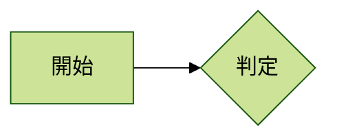

# Spec: Mermaid のテーマを選び、出力に反映する

**ID**: 24
**Date**: 2026-10-14
**Status**: Draft（rev1。起票 → P0 着地（「P0 結果」）→ D1〜D7・D4-2 を裁定（「裁定」）→ P1 着地（「P1 結果」、フォーク元 `d94a161`）→ **P2 着地**（「P2 結果」、`17889ab`）。P3（配布ビルド）待ち）
**Branch**: 切らない（Phase 単位で main へ直接コミット）。spec 15〜23 と同じく、**フォーク元の改善と台帳・デスクトップはコミットを分け**、フォーク元のコミットだけで上流へ PR を出せる形にする
（フォーク元のコミットは `lib/desktop/`・`src-tauri/`・`crates/` と台帳を含まない。PR を出すか・いつ出すかは利用者が決める, CLAUDE.md）

## Goal

利用者の言（2026-10-14）: 「Mermaid のテーマを切り替えられるようにしたい。ただ編集画面にテーマを被せるというより、出力ファイルにテーマが反映されるようにしたい」。
参考に挙げられた記事（Zenn、`zenn.dev/junkawa/articles/zenn-mermaidjs-theme-config`。2021-10 公開・2022-07 更新）は、図の先頭の `%%{init:{'theme':'base'}}%%` で default・dark・forest・neutral・base を選び、
`themeVariables`（`primaryColor` など）・`themeCSS` で色を変える形を書いている（frontmatter の `config` は扱っていない）。

**出力**とは、この spec では次の 3 つを指す（言葉の定義）:

- **書き出しの絵**: デスクトップの SVG・PNG・PDF（Rust の merman で描く）と、MCP の `render`
- **Mermaid のテキスト**: コード生成のダイアログのコード（コピー・`.mmd` のダウンロード）、保存される図の `source`、MCP の `read_diagram` が返す Mermaid
- **コード生成のプレビュー**: ダイアログの右の mermaid.js の描画（書き出しの前に見る絵）

**編集画面（xyflow のキャンバス）の見た目は変えない**（利用者の言）。保存ファイル・コード生成・書き出しの経路にテーマを通す。

## 裁定（2026-10-14、利用者。P0 の後）

**推奨どおり。D4-2 は外す**。

- **D1: 案 A** — テーマは図の Mermaid の先頭に書いて持ち回る（図ごと。`Document` に欄を足さない）
- **D2: 案 A** — frontmatter の `config.theme`。default の時は何も書かない。取り込みは frontmatter・init の両方を読む。
  GitHub・Zenn が frontmatter を読むかは確かめていない（P0 結果の「利用者に頼む確かめ」は未着手）。読まないと分かったら、書き方を見直す
- **D3: 案 A** — default・neutral・dark・forest の 4 つ
- **D4: 案 A** — GUI が扱うのはテーマの名前だけ。取り込みでテーマ以外の設定（`themeVariables`・`flowchart.*` など）が消える時は、消えるものの要約に出す
- **D4-2: 書き出しの守りから `themeVariables` を外す** — Mermaid のテキストに書いた `themeVariables`（AI が書いたものなど）が、書き出し（MCP の `render`・GUI の書き出し）にも効く。
  `themeCSS`・`fontFamily`・`altFontFamily` は守りに残す（`themeVariables.fontFamily` は外しても効かない, P0 結果の 5）。色として読めない値は、書き出しがエラーになる
- **D5: 案 A** — 書き出しの背景はテーマに合わせる（dark は #333、ほかは今と同じ白）。コード生成のプレビューの枠も同じ背景。`options.background` を渡した時はそれが勝つ
- **D6: 案 A** — コード生成のダイアログで選ぶ
- **D7: 推奨どおり** — `render` の `options.theme` は今のまま（図の中のテーマが勝つ）、`ThemeParam` は 4 つ、説明に一言

## 現況（2026-10-14、コードを読んで確かめた）

- **書き出しの口はもうテーマを持つ**: `lorelei_core::RenderOptions` に `theme: Theme`（`Default`・`Neutral`・`Dark`・`Forest`。`base` は無い, `crates/lorelei_core/src/render.rs:30-71`）。
  merman にはサイトの設定として `theme` を渡す（`engine.rs:27-34`）。図の中の `%%{init}%%`・frontmatter の `theme` はサイトの設定より勝つ（`theme` は上書きさせない鍵 `SECURE_KEYS` に入っていない）
- **使っているのは MCP の `render` だけ**: `render` の `options.theme`（`crates/lorelei_mcp/src/lib.rs:176-212`）。
  **GUI の書き出しは `RenderOptions::default()` に固定**（`src-tauri/src/desktop.rs:38-41`。テーマは default、背景は白、倍率 2）。書き出しのボタンはコード生成のダイアログの中（`lib/desktop/export-buttons.tsx`、デスクトップだけ）
- **生成器はテーマを書かない**: フローチャートの `generateMermaidCode`（`features/flowchart/hooks/mermaid.ts:302-377`）も ER 図の `generateERDiagramMermaidCode`（`features/er-diagram/utils/generate-mermaid-code.ts`）も、`%%{init}%%` も frontmatter も出さない
- **取り込みはテーマを黙って落とす**:
  - Web 版（mermaid.js の写し）: `prepareForParse`（`components/ui/mermaid-parse-issue.ts:43-54`）が `%%` で始まる行と先頭の frontmatter を空行にしてから読む。
    取り込むと消えるものの要約（`mermaid-dropped.ts`）にも載らない
  - デスクトップ・MCP（Rust の `to_editor`）: merman の前処理が frontmatter と init を読んで `meta.config` に入れるが、Lorelei は読まない（`EditorPayload` にテーマの欄が無い）。
    原文は `Document.original_source` に残るが、`source` は最初の自動保存で生成器の出力になり、テーマが消える。MCP の `update_diagram` も同じ（`normalize_pending` の後）
- **コード生成のプレビュー**: `mermaid.initialize({ theme: "default", … })`（`components/ui/mermaid-render.ts:18-37`）。mermaid.js 11.17.2 の `render` は毎回コードの中の init・frontmatter を当て直すので、**コードにテーマが書いてあればプレビューに効く**。
  プレビューの枠は `bg="white"` に固定（`mermaid-code-with-preview.tsx:47-48`）
- **Web 版**の出力は Mermaid のテキストだけ（`.mmd` のダウンロードとコピー）。SVG・PNG・PDF の書き出しはデスクトップだけ
- `Document`（`src-tauri/src/documents.rs:42-62`）にテーマや書き出しの設定の欄は無い。アプリにほかの配色の設定は無い（yamada-ui の色のモードも、設定画面の配色の欄も無い。CodeMirror は固定の暗い配色）

## 起票前の下調べ（2026-10-14、配布ビルドの MCP `render` で SVG を描かせた）

同じフローチャート（`A[開始] --> B{判定}`、`B -->|はい| C[終了]`）の先頭に書き方を変えて、ノードの四角の塗り（`.node rect` の `fill`）を読んだ。

| 図の先頭 | ノードの塗り | 線 |
|---|---|---|
| 書かない | `#ECECFF`（default） | `#333333` |
| `%%{init: {"theme": "dark"}}%%` | `#1f2020`（dark） | lightgrey |
| frontmatter `config: theme: forest` | `#cde498`（forest） | — |
| `%%{init: {"theme": "dark"}}%%` の ER 図 | `#1f2020` | — |
| base + `themeVariables.primaryColor: #6A7FAB`（init・一重引用符・frontmatter の 3 形） | `#fff4dd`（**base の既定のまま**） | `#0b0b0b`（`lineColor` も効かない） |
| テーマ名なし + `themeVariables` | `#ECECFF` | `#333333` |

- **テーマの名前は、init でも frontmatter でも、フローチャートでも ER 図でも書き出しに効く**
- **`themeVariables` は書き出しに効かない**。Lorelei の `SECURE_KEYS`（`engine.rs:13-25`）が、merman の既定の守り（`HARDENED_SECURE_KEYS`: `fontFamily`・`altFontFamily`・`themeCSS`・`themeVariables` などを図から上書きさせない）を写しているため。
  mermaid.js の既定の守りは `themeVariables` を含まないので、**今でもコード生成のプレビュー（mermaid.js）では効き、書き出し（merman）では効かない**食い違いがある（AI が `themeVariables` を書いた図で起きうる）
- **背景はどのテーマでも白**（SVG のルートに `background-color:white`。`RenderOptions.background` が無い時の merman の既定）。
  merman の写しのテーマの値（`vendor/merman-core/src/generated/theme_variables_11_17_2.json`）では、`background` は default・forest が white、neutral が #ffffff、**dark が #333**、base が #f4f4f4。
  dark は線が lightgrey・文字が #ccc なので、白い背景の上では見づらい（絵は見ていない。P0 で見る）

## 言葉の定義

```text
テーマ            = Mermaid の配色の名前。default / neutral / dark / forest (/ base)。図ごとに 1 つ
テーマの書き方    = Mermaid のテキストの先頭に書く。frontmatter (---\nconfig:\n  theme: dark\n---) か init (%%{init: {"theme": "dark"}}%%)
出力              = 書き出しの絵 (SVG・PNG・PDF、MCP render) と Mermaid のテキスト (コード生成・.mmd・保存の source・read_diagram) とコード生成のプレビュー
編集画面          = xyflow のキャンバス。この spec では見た目を変えない
```

## 決めること

### D1. テーマをどこに持つか

- **案 A（推奨 → 採る, 裁定）: 図の Mermaid のテキストに書く（図ごと）** — 生成器がテーマを先頭に書き、取り込み（Web・デスクトップ・MCP）はテーマを読んでエディタの状態に持つ。
  保存される `source`・コード生成・`.mmd`・`read_diagram` にそのまま入り、外（GitHub・Zenn・mermaid.live）に貼ってもテーマが効く。
  `Document` に欄を足さない（`source` が真実）。Web 版でも同じ形（フォーク元に返せる）
- 案 B: `Document` に `theme` の欄を足し、書き出しの時だけ使う — Mermaid のテキストにテーマが入らないので、`.mmd` やコピーを外に貼るとテーマが落ちる。Web 版には保存が無いので効かない
- 案 C: アプリ全体の設定（全部の図に同じテーマ） — 図ごとに変えられない。出力のテキストに入らないなら案 B と同じ穴

推す理由: 利用者の言の「出力ファイルにテーマが反映される」の中心は、書き出しの絵だけでなく Mermaid のテキストにもテーマが入ること（外の描き手でも同じ配色になる）。
案 A なら、取り込みで今テーマを黙って落としている穴（現況）も同時に塞がる。

### D2. テーマの書き方

- **案 A（推奨 → 採る, 裁定）: frontmatter の `config.theme`** — Mermaid の今の文書が推す書き方（init は古い書き方として残っている）。merman も mermaid.js 11.17.2 も読む（下調べ）
- 案 B: `%%{init: {"theme": "…"}}%%` — 参考の記事（Zenn）の書き方。古い Mermaid でも読める
- どちらでも、**default の時は何も書かない**（今の図の出力をバイト単位で変えない。受け入れ条件 6）。取り込みは両方の書き方を読む
- 外の描き手（GitHub・Zenn・mermaid.live）がどちらを読むかは P0 で確かめる（Zenn の Mermaid の版が古く frontmatter を読まないなら、案 B か、利用者が選べる形を考える）

### D3. 選べるテーマ

- **案 A（推奨 → 採る, 裁定）: default・neutral・dark・forest の 4 つ** — 今の `RenderOptions.theme`・MCP の `ThemeParam` と同じ。名前だけで配色が決まる
- 案 B: 4 つ + base — base は `themeVariables` で色を足すための土台で、名前だけだと薄いベージュの図になる（下調べ）。D4 で `themeVariables` を扱う時に足す
- merman は neo・redux などの新しいテーマも持つが、mermaid.js 11.17.2 で同じ絵になるかは分からないので入れない

### D4. `themeVariables`・`themeCSS` と、ほかの設定（`flowchart.rankSpacing` など）

- **案 A（推奨 → 採る, 裁定）: この spec では GUI はテーマの名前だけを扱う** — 取り込みでテーマ以外の設定は今どおり落とすが、**取り込むと消えるものの要約に「テーマ以外の設定」として出す**（今は黙って消える）
- **D4-2（P0 の後に足した決めごと → 外す, 裁定）: 書き出しの守り（`SECURE_KEYS`）から `themeVariables` を外す** — 書き出しにも効き、プレビュー（mermaid.js）との食い違い（下調べ）が消える。
  `themeCSS`・`fontFamily`・`altFontFamily` は守りに残す。色として読めない値は merman が描画ごとエラーにする（P0 結果の 5。CSS は差し込めない）。
  **取り込み（`to_editor`）の読みは今の守りのまま**にする（取り込みはどうせ `themeVariables` を落とすので、色の値で取り込みそのものが落ちないように。P2 で確かめる）。
  `validate` は書き出しと同じ設定で読む（`validate` が通って `render` がエラーになる食い違いを作らない。P2 で決めて確かめる）
- 案 B: `themeVariables` も GUI の状態に持ち回る — エディタが色を持つことになる。この spec の外（D4-2 で書き出しには効くので、AI が書いた色は `render` に効く）。
  `themeVariables.fontFamily` は同梱フォントの都合で効かせられない（spec 01 P0）。値が CSS に入るので、守りを外してよいかを merman のソースで確かめてから（P0 では材料だけ集める）
- 案 C: GUI で色を選ぶ — この spec の外

### D5. 書き出しの背景

- **案 A（推奨 → 採る, 裁定）: テーマの背景に合わせる** — 書き出しの背景を、テーマの `background`（dark なら #333）にする。default・forest・neutral は白のまま（今と同じ）
- 案 B: 今のまま白 — dark が見づらい
- 案 C: 透過 — 貼る先の背景しだいで、dark の線と文字が見えたり見えなかったりする
- コード生成のプレビューの枠（今は白に固定）も同じ背景にする。MCP の `render` で `options.background` を渡した時は、それが勝つ（今と同じ）

### D6. GUI のどこで選ぶか

- **案 A（推奨 → 採る, 裁定）: コード生成のダイアログ**（向きのメニューと書き出しのボタンの並び） — 出力に効く設定だと、その場で分かる。プレビューがすぐ変わる。
  Web 版とデスクトップが同じダイアログを使う（デスクトップのツールバーの「コード生成」もフォーク元のダイアログを開く。failures #17 の「どの操作がどの部品を開くか」は P1 で確かめる）
- 案 B: デスクトップのツールバー — 編集中に選べるが、Web 版には無い。キャンバスの見た目が変わらないので、選んだ効き目が見えない
- 案 C: 設定画面 — アプリ全体（D1 の案 C）向き

### D7. MCP

- `open_in_editor`・`update_diagram` に渡した Mermaid のテーマは、エディタの状態に残り、`read_diagram` で返る（D1 の帰結）
- `render` の `options.theme` は今のまま（図の中のテーマが勝つ）。`ThemeParam` の値は D3 に揃える。ツールの説明に、図の先頭に書いたテーマが出力に残ることを一言足す

## Phase

- **P0（リサーチ。着地, 「P0 結果」）**: 結果を「P0 結果」に表で書く。**コミットするコードは変えない**
  1. D3 の 4 つのテーマで、フローチャート・ER 図（枠・ラベル・向きを含む小さな図）を、merman（MCP `render` の SVG と PNG）と mermaid.js 11.17.2（コード生成のプレビューと同じ版）で描いて並べる。配色が揃うか
  2. dark の書き出しを、白・#333・透過の背景で並べる（D5）
  3. frontmatter と init を、GitHub（Markdown の mermaid の囲み）・Zenn・mermaid.live がそれぞれ読むか（**外へ公開する確かめは利用者に頼む**。Lorelei の側は merman と mermaid.js で読めることを確かめる）
  4. 取り込みの往復: テーマを書いた Mermaid を Web の取り込み・デスクトップの取り込み・MCP の `open_in_editor` で開き、何が残り何が消えるか（今のコードで。テーマ以外の設定も）
  5. D4 の案 B の材料: merman が `themeVariables` を守りに入れた理由（ソースと上流の履歴）、外した時に書き出しの絵が mermaid.js と揃うか
  - 結果で D1〜D7 を確定させ、rev1 → 裁定 → rev2
- **P1（フォーク元）**:
  - 生成器（フローチャート・ER 図）がテーマを frontmatter で書く（default は書かない。今の出力をバイト単位で変えない）
  - Web の取り込みがテーマ（frontmatter・init の両方）を読み、エディタの状態に持つ（フローチャートは向きと同じ持ち方にする）。テーマ以外の設定は消えるものの要約に出す
  - コード生成のダイアログ（フローチャート・ER 図）に、向きのメニューと並べてテーマのメニュー。プレビューの枠の背景をテーマに合わせる（dark は #333）
  - 足すテスト（Red → Green）: 生成器の frontmatter・default の時は何も書かない・取り込みの往復（frontmatter と init）・消えるものの要約・ダイアログのメニュー
  - Web 版の画面で確かめる（プレビューの配色と背景）。生成器の出力を変えたら fixture（`er_names.json`・`flow_subgraphs.json`）を書き直し、Rust のテストも回す（CLAUDE.md の開発コマンド）
- **P2（デスクトップ・Rust）**:
  - `to_editor` が merman の `meta.config` からテーマを読む（`EditorPayload` にテーマ）。テーマ以外の設定は `dropped` に出す。デスクトップの取り込み・MCP の `open_in_editor`・`update_diagram` の往復でテーマが残る
  - 書き出しの守りから `themeVariables` を外す（D4-2）。取り込みの読みは今の守りのまま。`validate` は書き出しと同じ設定
  - 背景（D5）: `RenderOptions.background` が無く、効いているテーマ（図の中が勝つ）が dark なら #333
  - デスクトップの書き出し（`export_diagram`）は、ダイアログのコードをそのまま描く（テーマはコードの frontmatter に入っているので、引数は足さない見込み。P2 で確かめる）
  - MCP の説明と `ThemeParam`・data_contract（`EditorPayload`・`RenderOptions`・`RenderConfigOverrides`・`MermaidImport`・`GuiCommands.export_diagram`）・LORELEI.md（既知の制約と MCP の説明）
  - `tauri dev` で MCP の往復と書き出しを確かめる
- **P3（配布ビルド）**: 利用者がテーマを選んで書き出し、SVG・PNG・PDF と `.mmd` を外で開いて確かめる

## 受け入れ条件

1. GUI でテーマを選ぶと、コード生成の Mermaid の先頭にテーマが書かれ、コピーと `.mmd` にも入る。保存される図の `source` と `read_diagram` にも入る
2. デスクトップの SVG・PNG・PDF の書き出しが、選んだテーマの配色（と D5 の背景）になる
3. コード生成のプレビューも、選んだテーマで描かれる
4. テーマを書いた Mermaid を取り込むと（Web・デスクトップ・MCP の `open_in_editor`・`update_diagram`）、テーマが残り、編集して生成し直しても消えない。テーマ以外の設定が消える時は、消えるものの要約に出る
5. 編集画面（キャンバス）の見た目は変わらない
6. テーマを選ばない（default の）図の出力は、今とバイト単位で同じ（Mermaid のテキストにも、書き出しの絵にも何も足さない）
7. Web 版（GitHub Pages）でも 1（`.mmd` とコピー）・3・4 が成り立つ（デスクトップ専用の変更を含まない）
8. （D4-2）Mermaid のテキストに書いた `themeVariables` の色が、書き出し（MCP の `render`）に効く。色として読めない値はエラーとして返る。取り込みは色の値で落ちない
9. （D5）dark の書き出しの背景は #333（SVG・PNG・PDF・MCP の `render` のプレビュー）。`options.background` を渡した時はそれが勝つ

## スコープ外

- 編集画面（キャンバス）にテーマを被せること（利用者の言）
- `themeVariables` を GUI で選ぶ・エディタの状態に持ち回ること（書き出しには D4-2 で効く）。`themeCSS` を効かせること
- テーマ以外の Mermaid の設定（`flowchart.rankSpacing`・`look`・`layout` など）を持ち回ること
- フォント（同梱の Noto Sans JP のまま。テーマの `fontFamily` は効かせない, spec 01）
- neo・redux などの新しいテーマ（D3）
- アプリの UI の暗い配色（ダークモード）
- 書き出しの線のラベルの背景が薄く、線が文字に透けること（`htmlLabels: false` の描き方、テーマに関係ない, P0 結果の 1）・ER 図の線のラベルの文字が箱からはみ出すこと

## P0 結果（2026-10-14）

**コミットするコードは変えていない**（使い捨てのテストは消した）。確かめた道具: 配布ビルド（`b113ccf` の作業ツリー）の MCP `render`・`open_in_editor`・`update_diagram`・`read_diagram`、
裏の Edge（Playwright、`channel: "msedge"`）で動かした mermaid.js 11.17.2（`node_modules/mermaid/dist/mermaid.min.js`。コード生成のプレビューと同じ初期設定）、vitest、`lorelei_core` の使い捨ての統合テスト。
図は、枠・線のラベル・点線・太線・ひし形・丸を含むフローチャートと、属性 2 つずつ・関係 1 本の ER 図（frontmatter の `config.theme` で指定）。

### 1. merman（書き出し）と mermaid.js（プレビュー）の配色（P0 の 1）

5 つのテーマ（default・neutral・dark・forest・base）× 2 種類の図を両方で描き、部品ごとの計算された色を比べた。

- **ノード（四角・ひし形・丸）・枠・線・線のラベルの背景の色・矢じり・ER の箱・行（奇数・偶数）・関係の線の色は、10 通りの全部で一致**
- 違ったのは 2 つ:
  - **SVG の背景**: merman は白で塗る（`RenderOptions.background` の既定）。mermaid.js は塗らない（透過）
  - **線のラベルの背景の見え方**: CSS は同じ（dark は `hsl(0,0%,34.4%)`）だが、書き出しは `htmlLabels: false` なので merman は「不透明度 0.5 の四角」で描き、
    mermaid.js は HTML のラベル（不透明）で描く。白の上では merman の方が薄く、線が文字に透ける（テーマに関係なく今もある違い。dark で目立つ）
- 文字の色は、merman は `<text>` の `fill`、mermaid.js は HTML の `color` で、見える色は同じ（並べた画像で確かめた）。ER 図の線のラベルは merman の方で文字が箱からはみ出す（書体の幅の違いと見ている。テーマに関係ない）

### 2. dark の書き出しの背景（P0 の 2）

dark のフローチャートと ER 図を、背景を白（今）・#333（dark の `background`）・透過で PNG に書き出して並べた。

- **白**: 枠の外の線（lightgrey）と線のラベルがほとんど見えない
- **#333**: 線・線のラベル・枠・文字が読める。線のラベルの 0.5 の四角も暗く混ざり、mermaid.js の見え方に近づく。ER 図の「0 以上」の丸（白で塗られる）が見えるようになる（mermaid.js も同じ塗り）
- **透過**: 貼る先しだい。明るいページでは白と同じになる
- → **D5 の案 A（テーマの背景に合わせる）を推す**

### 3. 外の描き手（P0 の 3）

- Mermaid の公式の文書は、init（ディレクティブ）を v10.5.0 から非推奨とし、frontmatter の `config` を推す（新しい機能は init に足さない）
- merman と mermaid.js 11.17.2 は、frontmatter・init のどちらでもテーマを読む（下調べと上の 1）
- **GitHub と Zenn が今どちらを読むかは、公開されている情報では分からなかった**（どちらも使っている Mermaid の版を出していない）。実物で試すのは利用者に頼む（下の「利用者に頼む確かめ」）

### 4. 取り込みの往復（今のコード、P0 の 4）

| 入口 | テーマ | テーマ以外の設定（`themeVariables`・`flowchart.rankSpacing`） | 消えるものの要約 |
|---|---|---|---|
| Web の取り込み（frontmatter・init） | 消える（取り込みの結果のどこにも無い） | 消える | 空（`dropped: []`） |
| MCP `open_in_editor`（frontmatter） | `original_source` にだけ残る。GUI が読み込むと `source` は生成器の出力になり、テーマが無い | 同じ | 空 |
| MCP `update_diagram`（init） | 直後の `source` は原文のまま。8 秒後には GUI が揃え直して消える | 同じ | 空 |

- **今は 3 つの入口のどれも、テーマを黙って落とす**（現況のとおり。要約にも出ない）

### 5. `themeVariables` の守りを外すと（P0 の 5、D4 の案 B の材料）

`lorelei_core` の使い捨てのテストで、Lorelei と同じ組み立て（`resvg_safe`・`htmlLabels: false`）の merman に、守りの一覧から `themeVariables` だけを外した設定を渡した。

- 外すと、図の `themeVariables` が書き出しに効く: `primaryColor`（ノードの塗り #6A7FAB）・`lineColor`（線 #ff0000）・`primaryTextColor`（文字 #FAFBF9）。今の守りのままだと、どれも効かない
- `themeVariables.fontFamily` は、外しても効かなかった（書体は同梱の指定のまま。トップの `fontFamily` は守りに残している）
- 色の値に CSS を混ぜると（`red;} svg{background:url(…)} …`）、merman は `Unsupported color format` で**描画ごとエラーにする**（色の値は CSS に入る前に色として読まれる）。
  外す危険は、色の値からの CSS の差し込みについては小さい。代わりに、色として読めない値を書いた図は、今は黙って無視されるのが、外すと書き出せなくなる
- merman が `themeVariables` を守りに入れた理由は、merman の文書と変更履歴には見当たらなかった（`HARDENED_SECURE_KEYS` に説明の注記も無い）。見当は、知らない人の図を描くサーバーで CSS を差し込ませないため（確かめていない）

### 利用者に頼む確かめ（P0 の 3 の残り）

次の 2 つの囲みを、GitHub（非公開の gist か、Issue・コメントの「Preview」）と Zenn（記事のプレビュー）に貼り、どちらが森の緑（forest）になるかを見てほしい。

````text



````

### 推奨（P0 の後 → 2026-10-14 の裁定で全部採った。D4-2 は外す。「裁定」）

- **D1: 案 A**（図の Mermaid の先頭に書く）。今の 3 つの入口がテーマを黙って落とす穴（上の 4）も、これで塞がる
- **D2: 案 A**（frontmatter。Mermaid の推す書き方）。ただし Zenn・GitHub が frontmatter を読まないと分かったら、init にするか、書き方を選べる形を考える（上の「利用者に頼む確かめ」の結果で決める）
- **D3: 案 A**（default・neutral・dark・forest）
- **D4: 案 A**（この spec で GUI が扱うのはテーマの名前だけ。取り込みでテーマ以外の設定が消える時は、消えるものの要約に出す）。
  これに加えて、**書き出しの守りから `themeVariables` を外すかを決めてほしい（新しい決めごと D4-2）**:
  - 外す（推奨）: AI が書いた色が書き出しにも効き、プレビュー（mermaid.js）との食い違いが消える。色として読めない値を書いた図は書き出しがエラーになる（今は黙って無視）。`themeCSS`・`fontFamily` は守りに残す
  - 今のまま: 食い違いは LORELEI.md の既知の制約に書く
- **D5: 案 A**（テーマの背景に合わせる。dark は #333、ほかは今と同じ白）。コード生成のプレビューの枠も同じ背景にする
- **D6: 案 A**（コード生成のダイアログ）
- **D7: 推奨どおり**（`render` の `ThemeParam` は 4 つのまま。説明に一言）
- **スコープ外に足す**: 線のラベルの背景が書き出しで薄く、線が文字に透けること（`htmlLabels: false` の描き方、テーマに関係ない）・ER 図の線のラベルの文字がはみ出すこと

## P1 結果（2026-10-14）

**フォーク元 `d94a161`**（`lib/desktop/`・`src-tauri/`・`crates/` と台帳を含まない。上流へ返せる形）:

- `components/ui/mermaid-theme.ts`（新しい）: テーマの型と 4 つの一覧（`MERMAID_THEMES`）、図の先頭の frontmatter（`themeFrontmatter`。default は空）、背景（`themeBackground`。dark は #333）、
  取り込みでテーマを取り出し、持てない設定を数える `themeFromConfig`
- 生成器: `generateMermaidCode(flowData, direction, theme?)`・`generateERDiagramMermaidCode(nodes, edges, direction, theme?)` が、default 以外のテーマを先頭に frontmatter で書く
- 取り込み（Web）: `readMermaidDiagram` の写しに図の設定（`config: { theme?, keys }`）を足した。frontmatter か init がある図だけ、`mermaid.parse` が返す設定を読む
  （プレビューの `render` と同じ前処理。読んだ後は `mermaidAPI.reset()` で `initialize` の値へ戻す）。
  `ParsedMermaidData`・`ParsedMermaidERData` に `theme?`（default は持たない）。テーマ以外の設定は `config:<名前>`、選べないテーマは `theme:<名前>` として消えるものに出し、
  要約では「設定 themeVariables ×1」「テーマ base（選べないテーマ） ×1」と書く
- エディタ: フローチャートと ER 図のエディタが、向きと同じ持ち方でテーマを持つ（取り込みで受け取る）。コード生成のダイアログに、向きのメニューと並べて `ThemeMenu`。
  プレビューの枠（`MermaidTwoPane`）の背景を外から渡せるようにし、コード生成のダイアログからテーマの背景を渡す（取り込みのダイアログは今のまま白）
- テスト（足した 4 ファイル・17 件）: テーマの部品（4）・フローチャートの生成と取り込みと往復（7）・ER 図（3）・ダイアログ（3）。
  直す前のコードで回すと 13 件中 11 件が落ちた（Red）。通った 2 件は「default の時は今までの出力と同じ」を押さえるもの（前のコードでも通るのが正しい）。
  既存の `download-modal.test.tsx` の 2 件は、生成器を呼ぶ引数が `(flowData, "TD")` から `(flowData, "TD", "default")` になったので期待を直した
- vitest の全件は 1 回目に 3 件（`direction-save`・`er-diagram-editor-delete`・`update-diagram` の重いテスト。単独ではどれも通る）が並列の時の待ちを超え、
  2 回目は 95 ファイル・1,152 件が全部緑で exit 0（failures #3 の形。本物の mermaid を読むテストが増えた）。`tsc --noEmit`・ESLint（import の順を 2 か所直した）は通り、
  整形は HEAD で整形済みの 8 ファイルと新しい 6 ファイルにだけかけた
- 生成器の default の出力は変えていないので、fixture（`er_names.json`・`flow_subgraphs.json`）は書き直していない（全件のテストで一致を確かめた）

### Web 版の画面（`next dev`、裏の Edge で押した）

- フローチャートのコード生成で dark を選ぶと、コードの先頭が `---`/`config:`/`theme: dark`/`---` になり、プレビューの枠が #333（`rgb(51, 51, 51)`）・ノードが dark の配色になった。default の時の枠は今までどおり（`rgb(251, 251, 251)`）
- `%%{init: {"theme": "forest"}}%%` で書いた図を取り込むと、メニューが forest になり、生成し直したコードは frontmatter の形（init は書かない）、プレビューは forest の配色
- ER 図のダイアログでも dark で同じ
- 後ろの編集画面（キャンバス）の見た目は変わらない
- デスクトップのツールバーの「コード生成」も、同じフォーク元のダイアログを開く（`useDesktopActions` の `code`。failures #17 の確かめ。画面で押すのは P3）

### P2 に回したこと

- デスクトップの自動保存（`lib/desktop/doc-session.ts` の `toSource`）は、まだテーマを書かない。P1 の時点のデスクトップでは、ダイアログで選んだテーマは書き出しとコピーには効くが、保存される `source` には残らない
- Rust の取り込み（`to_editor`）がテーマを読むこと・書き出しの守り（D4-2）・dark の書き出しの背景（D5）・data_contract・LORELEI.md

## P2 結果（2026-10-14）

**`17889ab`**（デスクトップ・Rust。フォーク元のファイルはパネル 2 つの `useDesktopActions` に `theme` を足しただけで、デスクトップの差し込みなので上流へ返す分は無い）:

- **デスクトップの自動保存**: `toSource(editor, nodes, edges, direction, theme)`。パネルが `useDesktopActions` に `theme` を渡し（`DesktopActions.theme`）、外枠は向きと同じくテーマの変化でも保存し直す。
  直す前は、テーマを書いた図を開くと最初の自動保存で生成器の出力（テーマ無し）になった（P0 の 4 の 2 行目。下のテストの Red で同じことを見た）
- **Rust の取り込み**: `to_editor` が merman の `ParseMetadata.config`（mermaid.parse の config と同じ形）を `editor.rs` の `theme_of` で読み、`FlowData.theme`・`ErData.theme`（default と書いていない時は持たない）にする。
  テーマ以外の設定は `config:<名前>`、選べないテーマは `theme:<名前>`（TS の `themeFromConfig` と同じ）
  - merman の config には、mermaid.js が図の設定から消す鍵（mermaid の既定の `secure`: `securityLevel` など 6 つ）も残っていた。TS の取り込みに揃えて数えない
  - `fontFamily` は、mermaid.js も merman も `themeVariables.fontFamily` にも写す（`config:fontFamily` と `config:themeVariables` の 2 つになる。両方とも同じ）
- **書き出しの守り（D4-2）**: `engine.rs` の守りを 2 つに分けた。書き出し（render・validate）は `themeVariables` を外し、取り込み（`to_editor`）は今までどおり守る。
  validate が失敗した時に図の種類を読むのは取り込みの守り（色が読めない図でも種類は分かる）
  - 色として読めない値は、merman が**解析の段階**で `ThemeColor` のエラーにする（描画まで行かない）。`validate` は ok=false・「図の設定 (themeVariables) の色を読めません (Unsupported color format: "nope")」・行は無し、`render` も同じ文のエラー
  - 取り込みは同じ図を落とさず、テーマは残し、`themeVariables` を消えるものに出す
- **背景（D5）**: `render_svg` が書き出しの守りで読んだ `effective_config` のテーマ（図の中が勝つ）を見て、`background` の指定が無く dark なら #333（ルートの `background-color:rgba(51,51,51,1)`）。SVG・PNG・PDF・MCP の preview が同じ
- **GUI の書き出し**（`export_diagram`）は引数を足していない。コード生成のダイアログのコード（P1 から先頭にテーマを書く）を `RenderOptions::default()` で描けば、テーマと背景はコードで決まる（src-tauri のテストで dark の背景と配色を確かめた）
- MCP の説明: `validate`（テーマは残る・`config:<名前>`・色が読めなければ ok=false）・`render`（図の先頭の theme と `themeVariables` の色が効く・`themeCSS` と `fontFamily` は効かない）・
  `open_in_editor`・`read_diagram`（テーマが残り、frontmatter で書かれる）・`options.theme` と `options.background`（dark は #333）
- 台帳: data_contract（`RenderOptions`・`EditorPayload` の `theme`・`MermaidTheme` の `import_rust`・`background`・`desktop`・`fixture`・`DesktopActions.theme`・`RenderConfigOverrides.secure`・`GuiCommands.export_diagram`）、
  LORELEI.md（「テーマ」の節・読み戻しの注意・既知の制約 3 つ）

### テスト（Red → Green）

- Rust（`lorelei_core`）: `core.rs` に 5 件（`themeVariables` が書き出しに効く・`themeCSS` と `fontFamily` は守ったまま・色が読めない値で validate と render がそろって失敗・dark の背景・テーマの無い図の背景は白のまま）、
  `editor.rs` に 4 件（frontmatter と init のテーマ・テーマ以外の設定・色が読めなくても取り込む・TS との突き合わせ）。直す前に回すと、`core.rs` の 3 件が落ちた（守りを外す・dark の背景・色の誤り）。
  通った 2 件は「今のまま変わらないこと」（守りに残す鍵・テーマの無い図）を押さえるもので、前のコードでも通るのが正しい。`editor.rs` の 4 件は、直す前は `theme` の欄が無くコンパイルが通らない形だった（直す前には回していない）
- 要の分岐を 1 つずつ壊して、別々のテストが落ちることを確かめた（mermaid.js が消す鍵を数える → TS との突き合わせ、default もテーマとして持つ → frontmatter と init の件、取り込みを書き出しの守りで読む → 色が読めなくても取り込む件）
- TS ↔ Rust の fixture: `crates/lorelei_core/tests/fixtures/themes.json`（21 通り。生成器の出力 4 テーマ × 2 種類と、AI が書きうる形 13 通り）。`__tests__/lorelei/themes-fixture.test.ts` が本物の mermaid.js の取り込みで期待どおりかを検めて書き、Rust が同じ theme と dropped になる
  - 揃えていない 1 つ: dark と読めない色を両方書いた init は、TS では mermaid.parse がその図の設定ごと失敗し、テーマも消えるものも持たない（Rust はテーマを残す）。どちらの描き手でも描けない図なので fixture に入れていない
- src-tauri: `export_to` が dark のコードを背景 #333・dark の配色で書く（1 件）。48 件が緑
- vitest: `doc-session.test.ts` に `toSource` のテーマ（1 件）、`theme-save.test.tsx`（2 件。テーマを書いたフローチャート・ER 図を開くと自動保存でもテーマが残り、コード生成のダイアログで変えたテーマで保存する）。直す前は 3 件とも落ちた
  - 全件では `theme-save` が 20 秒の上限を超えた（単独では 2〜3 秒。開く・ダイアログ・メニューを通す。failures #3 の形）。上限を 40 秒にし、default に戻す段（`toSource` の単体で押さえる）を外した。その後の全件 2 回は 97 ファイル・1,156 件が全部緑で exit 0
- `cargo test --workspace`・`cd src-tauri && cargo test`・clippy・`tsc --noEmit`・ESLint が通る。整形は HEAD で整形済みのファイルと新しいファイルにだけかけた

### `tauri dev` での確かめ（MCP の HTTP の口を直接叩いた）

このセッションの MCP の接続が切れていたので、README の GIF の時と同じく、設定ファイルのトークンで `127.0.0.1:39642/mcp` を直接呼んだ。

- `validate`: dark の frontmatter → ok・dropped 無し / base と `themeVariables` → ok・`config:themeVariables`・`theme:base` / 読めない色 → ok=false と上の文
- `render`: dark → ルートの背景 `rgba(51,51,51,1)`、preview の画像は #333 の上に dark の配色で線とラベルが読める / init の base と `primaryColor`・`lineColor` → ノードが #6A7FAB、線が赤（直す前は base の既定のまま, 下調べ） /
  読めない色 → ツール結果のエラー / dark に `options.background: "#ffffff"` → 白（指定が勝つ）
- `open_in_editor`（init の forest と `themeVariables`）→ opened・dropped `config:themeVariables`。すぐ後（開いて 1 秒ほど）の `read_diagram` は先頭が frontmatter の forest（init から書き直された）、`updated_at` は進まない（first_fill）
- `update_diagram`（init の dark とノードを 1 つ足した図）→ 2 秒後の `read_diagram` は frontmatter の dark と足したノード
- ER 図の `open_in_editor`（frontmatter の dark）→ `read_diagram` は frontmatter の dark のまま
- **GUI の画面（コード生成のダイアログ・SVG / PNG / PDF のボタン）は押していない**（computer-use で Lorelei を操作する許可が下りなかった）。書き出しの経路は src-tauri のテストで、ダイアログのテーマのメニューは P1 の Web 版の画面で確かめた。画面で押すのは P3
- 図の一覧に確かめ用の図が 2 つ残った（「spec24 P2 テーマの往復」「spec24 P2 テーマの往復 ER」）
- 見つけたこと: このセッションの PowerShell の `Get-NetTCPConnection` は、待ち受けている 39642 番を出さなかった（curl は 401 を返した）。待ち受けの確かめは curl で口を叩く

### P3 で確かめてほしいこと

1. コード生成のダイアログでテーマ（dark など）を選び、SVG・PNG・PDF を書き出して開く（dark は背景が #333、配色がプレビューと同じか）。`.mmd` とコピーの先頭に frontmatter が入るか
2. テーマを選んだ図を別の図に切り替えてから開き直すと、ダイアログのテーマが残っているか（保存される `source` に入る）
3. 編集画面（キャンバス）の見た目が変わらないか
4. （P0 の残り）GitHub と Zenn が frontmatter と init のどちらを読むか（「利用者に頼む確かめ」の 2 つの囲み）
